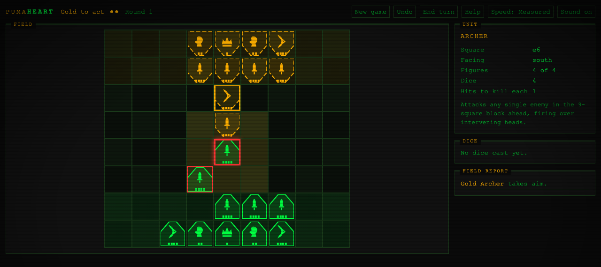
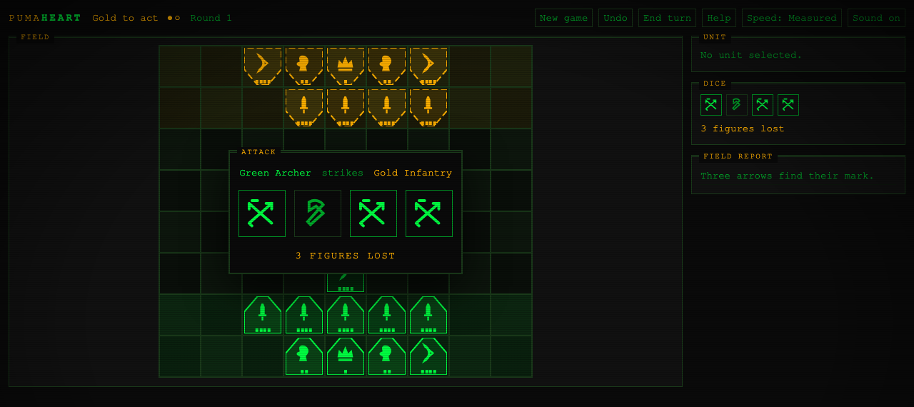
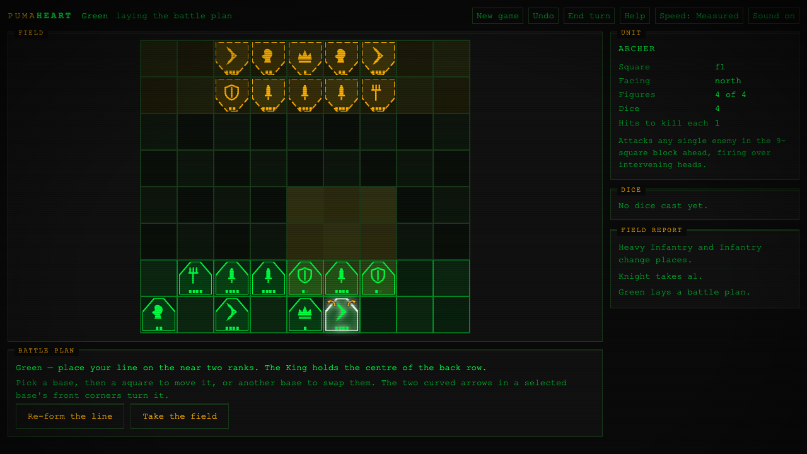
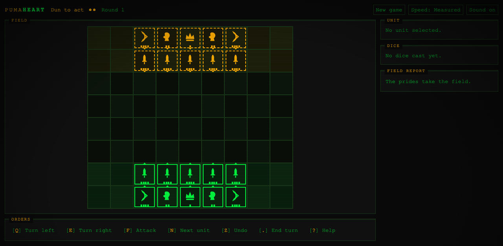
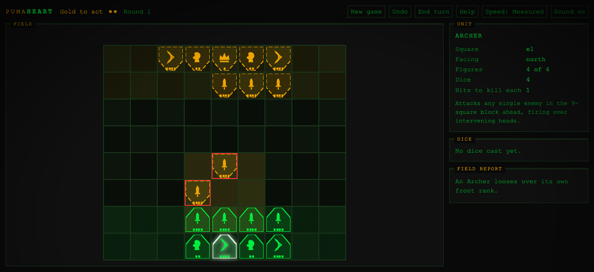
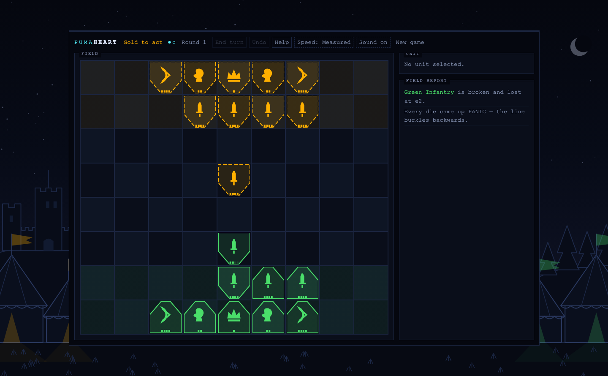
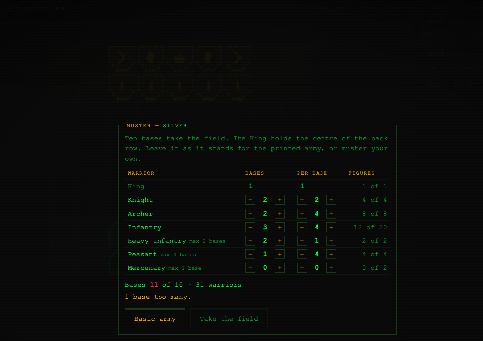
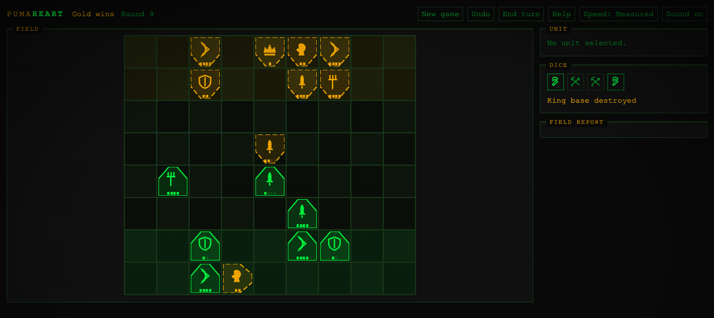

# PumaHeart

**A faithful port of Lionheart (Parker Brothers, 1997). Gold against Green on nine squares by eight, two actions a turn.**

A port, not a redesign. Every rule below is transcribed from the official Parker Brothers
rulebook for *Lionheart* — designed by Larry Harris, product `40742-I` — which Hasbro still
serves from its own instruction archive at
<https://www.hasbro.com/common/instruct/Lionheart.PDF>. There is no points system, no army
costs and no rebalancing, because the game has none of those things.

## Play

**<https://greykit.com/games/pumaheart/>**

One HTML file. No build step, no dependencies, nothing fetched at play time — load it once and
it works offline. Plays against an AI or two players on one screen, by mouse or entirely by
keyboard.

## How It Works

A unit is a **base holding one to four identical figures**, and the figure count is everything:
it is the unit's strength and its dice pool at once. A four-man Infantry base rolls four dice;
worn down to two men it rolls two. Attrition and firepower are the same number, which is why
there is no separate health bar anywhere in the game.

**Facing matters.** Foot moves one square forward per action; Kings and Knights ride as far as
they like in a straight line until something blocks them. You must be next to and facing what
you attack — though you may strike its side or rear. Archers are the exception: they hit any
single enemy in the block of nine squares ahead, firing over the heads of your own line.

**Two actions a turn**, taken from Move, Turn and Attack. The same action twice is allowed and
the two may be split between different units, but no unit attacks twice in a turn. Heavy
Infantry pays two actions to move or turn, and one to attack.

**The dice are three battle-axes, two arrows and one PANIC.** Most units hit on axes; Archers
hit on arrows; Peasants score with whichever they rolled the most of. Knights, Kings and Heavy
Infantry must take two hits in the *same* attack to lose a figure. Every attack is thrown in
full view: the dice tumble and settle one at a time, and the outcome is withheld until the last
one stops, and the board keeps the defeated base until the card has cleared, so you watch it go
rather than find it gone. When the AI attacks, the board calls the shot first — the attacker
rings in its own colour, its reach washes in, and the base about to be hit pulses red — so the
dice never arrive without saying who threw them. The field report keeps each attack as its four
faces and what the roll cost.

**PANIC is what makes the game.** If every die comes up PANIC the unit turns about and retreats
a square, shoving whoever is behind it into panicking too. A retreat blocked by the board edge,
an enemy, your own King or a Mercenary **kills the retreating unit**. Chain reactions are
normal, and they take your own line with them.

Win by killing the enemy King, or by leaving it standing alone on the field.










## Features

- **It opens on your own battle plan**, not a game already running. Muster ten bases, place
  every one of them, then take the field; a game in progress survives closing the tab.
- **You muster and place your own army.** Ten bases built from the figures you own, then
  **every one of them placed by you**: every base, the King included, goes anywhere on your two
  ranks, facing wherever you choose. Bunch in the middle or send
  the riders wide to turn a flank. Leave the muster and the line exactly as they stand and you
  get the printed Basic Game, square for square — which is why there is no separate "basic"
  mode to choose. In hot-seat both plans are laid in secret, behind the curtain that stands in
  for the rulebook's upright game box.
- **All seven warriors**, including the Extra Forces: Heavy Infantry that strikes any adjacent
  square without facing it, Peasants that panic once per PANIC die rolled, and Mercenaries that
  panic their victims, never panic themselves, and **change sides** when an enemy King bribes
  them.
- **Three AI difficulties.** Squire plays greedily and is blind to threats; Knight looks a turn
  ahead; Marshal searches wider. Measured over 150 games a side: Marshal beats Squire 93%,
  Knight beats Squire 90%, Marshal beats Knight 61%.
- **Hot-seat**, with a handover curtain standing in for the rulebook's upright game box.
- **Mouse-first**, with full keyboard play alongside it, a screen-reader commentary separate
  from the field report, and a reduced-motion path that skips animation entirely rather than
  merely disabling transitions.
- **House rules**, all off by default: three gaps in the 1997 rules where our reading is the
  default, the rulebook's own optional Massive Infantry rule, and the printed royal-emblem
  placement, which we play without. Each says in the menu where it comes from.

## The Warriors

Straight from the Gameplay Reference Table on page 8.

| Warrior | You own | Per base | Dice each | Hits with | Hits to kill each | Panics |
|---|---:|---:|---:|---|---:|---|
| King | 1 | 1 | 2 | battle-axe | 2 | never |
| Knight | 4 | 2 | 2 | battle-axe | 2 | yes |
| Archer | 8 | 4 | 1 | arrows | 1 | yes |
| Infantry | 20 | 4 | 1 | battle-axe | 1 | yes |
| Heavy Infantry | 2 | 1–2 | 2 | battle-axe | 2 | yes |
| Peasant | 4 | up to 4 | 1 | axe **or** arrow | 1 | per die |
| Mercenary | 2 | 2 | 2 | battle-axe | 1 | never |

No unit ever rolls more than four dice, because the box contains exactly four.

## What's Approximated

Short, for once, because we have the rulebook. Everything above is printed rule. The 1997 rules
are genuinely silent on four points and these readings are ours. One further entry is not a gap
at all — it is a printed rule we play without, and it is a house rule you can switch back on:

1. **Which basic bases you drop when customising.** The rules fix ten bases and cap each
   special, but never itemise the trade. We let the figure pool do that work.
2. **Whether a base may be under-filled.** The table prints fixed counts for basic units but the
   Massive Infantry rule calls four *"the standard limit"*, so we read them as maxima. The
   strict reading is a house rule.
3. **How a turn-order tie is broken.** Most battle-axes goes first; equal counts are not
   addressed. We re-roll.
4. **Whether a rider may move zero squares.** Not addressed. We require at least one, so a
   "move" cannot be used as a free pass.
5. **Where the King starts.** The rulebook is not silent here — p.6 says *“Your King must
   start on the royal emblem in the back row.”* By default we play without it: the King deploys
   anywhere on your two ranks like every other base. Because the rule is printed rather than
   absent, it is a house rule rather than a reading — **King starts on the royal emblem** in the
   New Game menu puts it back, and pins the square against swaps too.
6. **Whether a lone Peasant gets the two-hit re-roll.** It is printed for Infantry and extended
   to Archers, but Peasants are never mentioned though they also roll one die a figure. We
   extend it, since one die could otherwise never produce the two hits armour needs. The literal
   reading is a house rule.

Plus one thing that is not a rule at all: the **60-round limit** exists so headless simulations
terminate. It is off in human play.

## The Board Is 9×8, Not 9×10

Worth stating plainly, because every source online says otherwise. Wikipedia says *"played on a
9 by 10 board"*, and everything downstream repeats it. That traces to a single hedged sentence
in a 1998 *InQuest Gamer* #33 capsule review — *"basically a 9x10 square chessboard"* — and it
is wrong.

The board is **9 files by 8 ranks**, confirmed five ways: the width is countable in the
rulebook's own setup diagram on page 3; a physical board counts eight rows; BoardGameGeek files
the game under *Components: 8 x 9 Grids*; a BGG strategy thread notes the armies start *"a mere
4 squares apart"*, which only works at eight deep; and the board's fold bisects the centre
column, which is possible only if the column count is odd.

It matters. Four empty ranks separate the armies, so contact arrives almost immediately and a
rider threatens from the opening position.

## Also plays by keyboard

Everything is done with the mouse: click a base, then a square to
move it or a ring to attack; the two curved arrows in its front corners turn it. These
shortcuts mirror that for anyone who prefers them.


| Key | |
|---|---|
| arrows / WASD | move the cursor |
| Enter / Space | select, move or attack, by what is under the cursor |
| 1 – 4 | face north, east, south, west |
| Q / E | turn left / right |
| F | attack ahead |
| N / P | next / previous unit with a legal action |
| Z | undo (an attack seals everything before it) |
| . | end turn |
| ? | help · M mute · Escape dismiss |

## Tech

One HTML file, vanilla JavaScript, no dependencies and no build. Art is drawn as SVG paths and
sound is synthesised with Web Audio, so nothing is fetched at runtime. State lives in
`localStorage` under `pumaheart_save_v1`; the RNG seed is stored inside the save, so a game
replays exactly.

The rules engine is pure and DOM-free, which is what lets the same code drive the human, the AI
and the headless simulations. Open the console:

```js
__PH.ruleTests()          // 44 hand-built positions, including every blocked-retreat case
__PH.runSim(300)          // headless games, invariants asserted on every step
__PH.runMatch(0, 2, 100)  // Squire versus Marshal
```

The AI reads exact probabilities from a pre-computed dice distribution rather than rolling, so
it never touches the shared RNG stream — asserted, not assumed.

Screenshots regenerate from fixed seeds: `#shot=basic`, `muster`, `deploy`, `combat`, `archer`,
`panic`, `midgame`, `gameover`.

## Other Puma Games

[PumaTriage](https://greykit.com/games/pumatriage/) ·
[PumaSOC](https://greykit.com/games/pumasoc/) ·
[PumaSecure](https://greykit.com/games/pumasecure/) ·
[PumaPanic](https://greykit.com/games/pumapanic/) ·
[PumaResponse](https://greykit.com/games/pumaresponse/) ·
[PumaTower](https://greykit.com/games/pumatower/) ·
[PumaClicker](https://greykit.com/games/pumaclicker/)

## Credits

*Lionheart* was designed by **Larry Harris** and published by **Parker Brothers** in 1997. This
is an unofficial fan port of a long out-of-print game, built from the publisher's own rulebook.
All rules, army names and unit names are theirs; the artwork and the code are not.

Game code by shandower with AI assistance from Claude.
